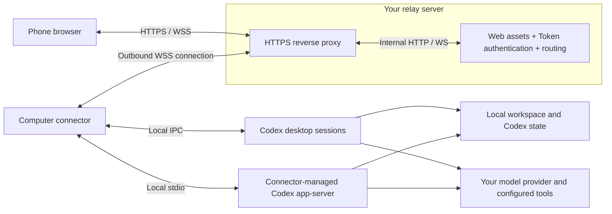

# Codex Mobile Web

English | [简体中文](README.zh-CN.md)

Continue using Codex on your computer from your phone, through a relay you host.

Browse projects and conversations, send instructions, steer or stop a running task, and respond to Codex approvals from a mobile browser. Execution stays on your computer, with its existing workspace, model configuration, and tools. No mobile app or project-operated account service is required.

Switch between **Codex / Antigravity / Claude Code** on the same computer and self-hosted relay. Returning to an app restores its conversation. Antigravity opens existing Windows desktop conversations and supports text and voice replies, model selection, stopping a task, and file previews. Claude Code runs sessions on the computer with new chats, replies, stopping and approvals. A project is a folder: its instructions, MCP servers and memory are Claude Code's own `CLAUDE.md`, `.mcp.json` and memory folder, so the terminal and the desktop app use them too. [Claude Code notes](docs/claude-local/DESIGN.md) · [Antigravity implementation](docs/antigravity/IMPLEMENTATION.md)

## Features

- Discover existing projects and conversations, including archived conversations.
- Voice input works the same in Codex, Claude Code and Antigravity. Choose Claude transcription, Codex transcription or the system keyboard in each app's home options or its “＋ → 语音输入”; the browser remembers one choice for all three. Claude is the default and uses the same streaming dictation service as Claude Code's own voice mode: tap the microphone and speak, the words appear in the draft as you talk, and tapping ✓ ends the dictation with a final corrected pass, without sending. It requires HTTPS, microphone permission and Claude Code signed in with a claude.ai account on the computer; a computer without Claude Code falls back to Codex. One dictation lasts up to ten minutes. Codex transcription records one clip of up to two minutes and transcribes it whole after ✓, using the computer's Codex ChatGPT login. Audio passes through the relay and connector to the desktop's private services. Phone compatibility still requires manual verification.
  If the computer needs a proxy, set `HTTPS_PROXY` (or `HTTP_PROXY`) before starting the connector. Voice requests also respect `NO_PROXY`; lowercase variable names are supported.
- Start or continue tasks, follow progress, add instructions, stop a turn, and answer supported approvals or questions.
- Consecutive tool activity is collapsed in the timeline.
- Tap a suggested follow-up to fill the composer; in-app back buttons return to the parent list.
- Long-press a conversation on mobile or right-click on desktop to pin, organize, mark unread, copy its ID, rename or archive it. Pins, sections and unread marks stay in this browser per computer; rename and archive update Codex.
- While a task runs, sending defaults to the queue above the composer. Each entry has icons to steer the active turn, withdraw to the composer, or delete; in Claude Code it can also be sent at once, interrupting the reply. Withdrawal preserves text, images, settings and the existing draft. Queued messages run in order on the connector, even after closing the page.
- Choose the next turn's model, reasoning effort, fast mode and approval policy inside the composer. Models and fast tiers come from the runtime catalog; there is no custom model-ID field.
- Open the top-right status ring to see the thread ID, directory, context usage, account limits and reset times. Missing native statistics are shown as unavailable.
- Preview Markdown, highlighted code, visual task diffs, images, videos and PDFs in a bottom sheet on phones or a right pane on desktop. PDF file citations open directly with page navigation and zoom. Download other files such as PowerPoint and ZIP. Select or paste images, including image Base64, with a count and clickable previews before sending. Image attachments require runtime-confirmed model support.
- Open a local web page through the relay; the phone renders it directly while the connector forwards requests to the project's `localhost`.
- Upload original PDFs, Word documents, spreadsheets, text and other files through “＋ → 添加文件”. Remove before sending, send without text, queue, withdraw or steer with files. Images and files share a limit of 10 attachments. Each document can be up to 100 MiB, uploaded in chunks with progress and resumable retries while the page stays open. Compressed images retain a separate 8 MiB message limit. Documents are saved under the current project's `.codex-mobile-attachments/` and passed to Codex as file links; reading a format depends on tools on the computer. Office files have no inline preview. Update the web app, relay and connector together.
- Reconnect after a browser disconnect, retain text drafts, and check uncertain operations without automatically resending them.

Closing the phone page does not stop Codex. The computer must remain on and connected. The relay is not a backup service and cannot execute tasks or supply stored conversation history while the computer is offline.

Each conversation can hold up to 20 queued messages. The connector stores their text, images, file references and selected settings until dispatch or removal. A failed or uncertain dispatch pauses that conversation's queue and is never retried automatically. After a connector restart, a connector-owned conversation may need “在这里继续” before its queue can proceed.

## Privacy

- You choose and operate the relay. The bridge has no built-in analytics, advertising, or telemetry endpoint operated by this project.
- The relay application does not persist conversation history or project files, but it can read forwarded content. There is no end-to-end encryption; use a trusted relay with HTTPS/WSS for public access.
- Model requests go from your computer to your configured provider. The bridge does not deliberately upload model credentials, but secrets in messages, tool output, or file previews travel with that content.
- The shared Token grants access to projects and conversations on connected computers, without per-device or per-project permissions. File previews and downloads use the connector's OS permissions and can read outside the selected project, subject to their respective size limits.

See [Privacy details](PRIVACY.md#english) for data storage, Token revocation, and removal.

## Architecture



This shows the recommended public HTTPS deployment. TLS ends at the reverse proxy. The proxy-to-relay connection stays on the same host or private container network; both are trusted components.

The connector uses local desktop IPC for existing desktop sessions, and a Codex app-server child process for sessions it creates or resumes. It releases its sessions after the task and queued sends finish, allowing the desktop to open them. Reading history does not reacquire ownership; sending resumes the session as needed. Active tasks, pending approvals and empty sessions without a saved first turn remain attached. Other sessions without a reachable live owner show history and require confirmation that the original task has ended before resuming here. Active standalone CLI sessions cannot be taken over.

On Windows, an unset `codexBin` uses the newest Codex in the desktop installation before checking PATH. Restart the connector after a desktop update when its tasks are idle. An explicit execution binary path remains pinned until changed. Model and reasoning options come from the execution runtime. With CLI 0.160.0, set `legacyCodexBin` to CLI 0.146.0 if you need to edit legacy conversations: it only rolls back history; all model requests use the current execution runtime.

`npm run check` requires an installed Codex and includes the isolated native protocol fixture. After deploying, run `npm run check:deployed`: it reads the running connector through the relay and fails when its executable or native version differs from the current desktop installation, or when provenance is missing. Its receipt is `.local/runtime-check.json`. These checks do not call ChatGPT or exercise the page; live model replies and page interactions still require manual acceptance.

For a Windows source checkout, `npm run update:check -- --apply` detects desktop package, CLI executable and compatibility code changes. It caches successful checks for that exact installation, runs type checks, regressions, the native fixture and a build on changes, and checks the deployed connector's build hash. When only the runtime needs switching, it waits for all connector-owned sessions and operations to be idle, blocks new operations during the switch, and restores the sessions; a failed switch attempts to restore the previous executable. Unsaved empty sessions also defer switching. Failed checks or an old connector build return an action for the maintenance agent and never advance the accepted baseline. `--retry` reruns cached failed checks. State, the latest result and detailed checks are in `.local/update-check.json`, `.local/update-check-last.json` and `.local/update-check.log`. Run `scripts/windows/update.ps1` on demand; the desktop launcher on this machine starts missing services using the existing configuration, leaves running services in place, then checks and applies connector updates while keeping its result window open. It does not schedule recurring work. Protocol repairs and relay web deployments that need Codex are reported with their logs.

If the result requests `deploy-connector`, `npm run update:deploy` deploys the checked build using the connector's 60-second idle guard, stops only the recorded connector process, and restores its complete loaded session set. It requires a matching last accepted bundle for rollback; the result is saved in `.local/connector-update-receipt.json`. Then run `update:check -- --apply` and `check:deployed` to verify and advance the baseline. The detector also compares the relay's actual page entry against the checked web build and returns `deploy-web` if it differs. The maintenance agent deploys the relay's web assets before the baseline can advance.

The relay keeps connection routes in memory; the connector stores operation IDs and receipts in local SQLite. After reconnecting, the browser fetches current state and checks earlier operations. Uncertain results remain pending rather than triggering an automatic retry. Restarting the connector may interrupt its own app-server tasks; its stop script does not stop the separate Codex desktop process.

Implementation: [web/](web/), [relay.ts](src/server/relay.ts), [control.ts](src/connector/control.ts), [desktop.ts](src/connector/desktop.ts), and [ledger.ts](src/connector/ledger.ts). More detail is in [DESIGN.md](DESIGN.md) (Chinese).

## Getting started

You need Windows with working Codex, a phone browser, and a relay reachable by both. Keep Codex desktop running under the same OS user as the connector to control existing desktop sessions.

### Windows connector

To let Codex on another computer handle installation, ask it to install `skills/codex-mobile-web-setup` from the GitHub repository `hzx829/codex-mobile-web`. On the next turn, use `$codex-mobile-web-setup` with your existing relay URL. The skill downloads and verifies the portable release, detects local Codex, starts the connector, and checks the connection without creating a task. Enter the Token once in a local masked dialog, or provide a local Token file. GitHub sign-in does not transfer relay credentials. See [the setup skill](skills/codex-mobile-web-setup/SKILL.md).

Download the Windows ZIP from [Releases](https://github.com/hzx829/codex-mobile-web/releases), extract it and run `Codex Mobile Web.exe`. It lives in the system tray; clicking the icon opens its window. The first run sets up the connection there; afterwards the services start in the background and the window shows their status, which of Codex / Claude Code / Antigravity were detected, the QR code and “在浏览器打开” (open in browser), so it can be used from a phone or a desktop browser. Start, stop, settings, logs and login startup are in the window and the tray menu, with no console windows. The window uses Windows' built-in WebView2; on the rare computer without it the tray falls back to the browser connection page and the old settings form. Node and the built application are included; Codex must already be installed separately.

From a source checkout, install Node 24 and run in the repository directory:

```powershell
npm ci
npm run build
.\start.cmd
```

The first launch opens setup. For a local trial, select “本机中继” (local relay), join the same trusted Wi-Fi on your phone, and scan the QR code. Local mode uses unencrypted HTTP. For public use, deploy the HTTPS relay below, then select “连接自己的中继” (your own relay), enter its HTTPS URL and shared Token, and start the connector. Projects are discovered automatically.

### Public relay

On Linux with Docker Engine and Compose v2, use a source checkout or an extracted relay package from [Releases](https://github.com/hzx829/codex-mobile-web/releases). Point a domain at the server and allow TCP 80/443/3341. In that directory:

```sh
cp .env.example .env
chmod 600 .env
openssl rand -hex 32
```

Edit `.env`: set `DOMAIN` to your hostname without `https://`, and `BRIDGE_TOKEN` to the generated value. Then run:

```sh
docker compose -f compose.yaml -f compose.https.yaml config --quiet
docker compose -f compose.yaml -f compose.https.yaml up -d --build
curl --fail https://your-domain.example/health
```

Replace `your-domain.example` with your hostname. The supplied Caddy configuration provides HTTPS for the main site and preview port 3341; relay ports 3340/3341 are published only on server loopback. The computer connects outbound, so no router port forwarding to it is needed. Source builds download npm dependencies; prebuilt relay packages only need the base container images.

See [DEPLOY.md](DEPLOY.md) (Chinese) for existing proxies, upgrades, rollback, and troubleshooting.

### Connect and manage

Scan the connector's QR code or open your relay URL and enter the same Token. The browser remembers it for that site. Treat the QR code like a password. Once connected, select a project, open a conversation, or start a new task.

To preview a web app, start its development server on the computer. Open an existing conversation, choose “打开本机网页” from the top conversation menu or the composer’s “＋” menu and enter a local URL such as `http://127.0.0.1:5173`. The address is saved per computer and thread. The page opens in the preview pane, with a separate-tab option for sites that block embedding. Switching threads keeps the preview pane and web proxy running; closing the pane also keeps the proxy session. “结束预览” or switching computers stops it. Each connector supports one active preview. The relay and connector tunnel HTTP and WebSocket requests instead of streaming screenshots. The preview port is the relay port plus one (3341 by default). Projects with hard-coded `localhost` URLs or Host/Origin restrictions may need changes.

In the portable package, change settings from the window's gear button or the tray menu (“连接设置”); in a source checkout, stop it and use `configure.cmd`. Stopping (tray menu or `stop.cmd`) stops the connector and its Codex child process, so finish connector-managed tasks first. Setup, optional login startup, and uninstall instructions are in [QUICKSTART.md](QUICKSTART.md) (Chinese).

## Compatibility and limits

| Component | Version |
| --- | --- |
| Computer | Windows x64; portable package includes Node 24.11.1 |
| Codex CLI | 0.160.0; 0.146.0 for legacy history rollback |
| Codex desktop | 26.901.6511.0 IPC adaptation; desktop upgrades may require changes |

Models use your existing local Codex configuration. The connector is currently available for Windows; macOS and Linux connectors are not supported.

Click a file link in a reply, choose “下载文件” (download), then “保存到设备” (save to device) after receiving it. You can also enter a path in the conversation menu's “查看项目文件” option. Files transfer on demand from the selected computer without a relay copy; the computer must stay online. Downloads up to 100 MiB show progress and can be cancelled. File changes or disconnections fail explicitly; reopen the file to retry. Closing the file panel cancels reception and releases temporary content. Update both the relay web application and the computer connector to enable this feature.

Task diffs support file selection, syntax and inline-edit highlighting, unified and side-by-side views. Markdown files support relative file links and local images. PDFs open in the preview pane with page navigation, zoom and saving. Password-protected or unsupported PDFs can be saved and opened on the device. PowerPoint and other Office formats have a download entry only. Update the web application, relay and connector together. Preview UI acceptance remains manual; see [acceptance steps](ACCEPTANCE.md).

Current limits: latest 100 turns per conversation view, truncated large output, text/image previews up to 2 MiB, file downloads, PDF previews and video playback up to 100 MiB, and up to 10 PNG/JPEG/WebP attachments, accepting originals up to 20 MiB each and automatically compressing oversized images to at most 2 MiB each and 8 MiB per message. MP4, WebM, OGV and MOV load on request into browser memory and use the browser's native decoder. Code views show up to 10,000 lines. Downloads are assembled in browser memory without resumable transfers. No background push or active standalone CLI takeover. Named Codex profiles are rejected for connector-managed app-server sessions on the tested CLI baseline.

## Development and provenance

```sh
npm run check
npm run build
npm run package:windows  # run on Windows
npm run package:relay
```

Packages go to `release/`; local configuration and operation records go to `.local/`. Both are excluded by `.gitignore`.

Independently implemented in TypeScript, with architectural research from **Codex Anywhere** and **Remodex**. Fixed references and attribution are in [SOURCES.md](SOURCES.md). Their pairing and encryption implementations are not included.

Licensed under [MIT](LICENSE). Packages include third-party dependency licenses and, on Windows, the bundled Node license.
