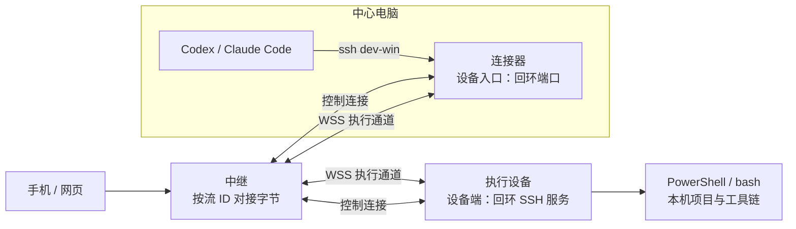

# 执行设备：设计（草案）

状态：草案，未实现。日期：2026-11-24。为后续方案铺路，动手前按 §11 逐项确认。

## 1 要解决的问题

现在每台接入的电脑都是一个完整的运行端：装 Codex / Claude Code、登录账号、跑连接器，会话固定在这台电脑上，agent 只能动这台电脑的文件和命令。

团队里常见的用法是一台中心电脑（Mac mini 或 Windows 主机）挂订阅、跑 agent，大家从手机和电脑浏览器提交任务。这时有两类需求做不到：

- 中心是 Mac，但要在 Windows 上打包、测试；或者要看一台测试机、构建机、NAS 的状态。现在只能让那台机器也装 agent、登录账号，作为另一台独立的电脑接入，两边的会话不通。
- 代码在成员自己的电脑上，希望中心的 agent 直接在那里改、在那里跑。

**执行设备**：只负责执行、不跑 agent、不需要订阅的机器。中心电脑上的会话经中继用 `ssh` 操作它。

## 2 和已有功能的关系

| 功能 | 管什么 | 和本设计的关系 |
| --- | --- | --- |
| 团队账号（[team/DESIGN.md](../team/DESIGN.md)） | 人：谁能登录、能用哪台电脑、谁做了什么、用了多少 | 执行设备的授权挂在团队已有的“电脑”和“电脑授权”上（§6），不另建一套 |
| 访客模式（[guest-mode/DESIGN.md](../guest-mode/DESIGN.md)） | 借别人的电脑跑 agent，工作区隔离 | 访客电脑仍是运行端；执行设备上没有 agent |
| 预览隧道（`src/server/preview-tunnel.ts`） | 手机看电脑上 `localhost` 的页面 | 方向相反：那是手机进电脑，这是电脑出到另一台电脑 |
| 数据通道（[sync/DESIGN.md §8](../sync/DESIGN.md#8-数据通道)） | 文件经中继以 HTTP 流直传 | 沿用“控制连接通知、一次性流 ID、两头各连中继、中继对接”的做法；字节通道换成 WebSocket（§5） |

## 3 参考：CC Desk Tunnel

[sun168567/cc-desk-tunnel](https://github.com/sun168567/cc-desk-tunnel)（Apache-2.0，读的是 `dbc4dda`，0.3.18）把 Claude Code 放在 Linux 服务器上，个人的每台电脑经反向隧道成为执行端。它是单人自用，我们是多人共用一台中心电脑，所以只借它的执行通道，不借它的整体结构。值得照搬的约定：

- **用 agent 本来就会的 `ssh`，不做执行用的 MCP。** 提示词告诉它“设备在 `ssh device-<名字>`”，`scp` / `sftp` 也随之可用。命令审批仍由 agent 自己做，审批卡片上就是 `ssh device-xxx …`。
- **设备主动连出，不开入站端口。** 每次连接临时生成 SSH 主机密钥和登录密钥，断开即作废；设备上不装系统服务。Windows 随包带 OpenSSH，以当前用户在回环上起 `sshd`；macOS / Linux 在应用自己的进程里用 `ssh2` 起 SSH 服务，不开启系统的“远程登录”。
- **转发只对接字节，不解析 SSH。** 每条 SSH 连接独占一条 WSS，连接复用交给 SSH 自己（`ControlMaster`），不自己做多路复用，也不放进控制连接。
- **固定入口，密钥随连接更换。** 每台设备在中心有固定的回环端口和 SSH 配置路径，设备重连只换密钥，正在跑的会话看不到变化；设备不在时新命令在入口等待一段时间。
- **提示词不放会变的东西。** 设备列表、路径都不写进提示词，只写一句固定的话，提示缓存不受设备上下线影响。
- **Windows 上脚本走标准输入。** `device-pwsh` 读完整段标准输入再执行（PowerShell 的 `-Command -` 逐行处理会丢跨行块），并统一 UTF-8；见它的 `docs/native-runtime.md` 与 `docs/research/windows-shell-windows.md`。

相关源码：`apps/server/src/tunnel.ts`、`apps/desktop/electron/tunnel-channels.mjs`、`windows-ssh.mjs`、`posix-ssh.mjs`、`ssh-keys.mjs`、`ssh2-hardening.mjs`；评估记录 `docs/research/linux-client-and-tunnel.md`。移植代码时保留版权声明，并在 NOTICE 里注明。

## 4 总体结构



- **设备端**：连接器的一种运行方式（`--device`），不加载 Codex / Claude / Antigravity，只保持一条到中继的控制连接，按需起回环 SSH 服务。托盘显示“正在被 <中心电脑> 使用”，可随时暂停接入。
- **中继**：认出设备，检查这台中心电脑能否用它（§6），把两头的执行通道对上。看到的只有 SSH 的密文：内容在中心和设备之间端到端加密，这一点比现在的控制连接更好。
- **中心电脑的连接器**：为每台可用设备开固定的回环入口，写 SSH 配置，告诉 agent 设备在哪（§7）。

## 5 执行通道

### 连接建立

```text
设备端 ── 控制连接，设备 Token ──▶ 中继：设备上线
中继 ── devices 广播 ──▶ 有权使用它的中心电脑的连接器
中心连接器：为这台设备开回环入口（端口固定），写 SSH 配置
中心连接器 ── device.keys（经中继）──▶ 设备端：本次连接的登录公钥
设备端：生成主机密钥，起回环 SSH 服务，只认这把登录公钥
设备端 ── 主机公钥 ──▶ 中心连接器：写进 known_hosts，探测一次，就绪
```

### 每条 SSH 连接

```text
agent 的 ssh ── TCP ──▶ 中心连接器的设备入口
中心连接器 ── tunnel.open {device} ──▶ 中继：检查授权，生成一次性流 ID
中继 ── tunnel.open {流 ID} ──▶ 设备端
中心连接器、设备端 各自 ── WSS /tunnel/<流 ID> ──▶ 中继
中继：把两条 WSS 对接，之后两个方向都只是 SSH 的字节
设备端 ── TCP ──▶ 本机回环 SSH 服务
```

- 流 ID 与数据通道一样：中继生成、只经控制连接发给两端、60 秒内未用即作废、只能用一次。
- 中继按两个 WSS 的背压互相暂停读取，不在内存里攒数据。
- 心跳：每条执行通道各自 ping，两次没有应答就关掉，只影响这一条 SSH 连接；下一条命令建立新的通道。SSH 自己的 `ServerAliveInterval` 兜底。
- 不走数据通道的 HTTP 流：那是单向的，SSH 要双向。

### 设备离线

中心入口不随设备上下线关闭。设备不在时新连接在入口等待最多 60 秒（等它重连），超时就以连接失败结束，agent 看到的是普通的 `ssh` 错误。

## 6 授权

### 第一阶段：团队共用的机器

团队模式下中心电脑上所有成员的任务都以同一个系统用户运行，成员之间不隔离（[team/DESIGN.md §2](../team/DESIGN.md#2-目标与不做)）。在这个前提下，任何一个成员的会话都能读到中心电脑上的设备配置和密钥，中继也分不出一条 SSH 连接是谁的会话发起的。所以第一阶段**授权的单位是中心电脑，不是人**：

- 执行设备由管理员登记，和电脑一样发设备专用 Token。
- 管理员为每台设备选择哪些中心电脑可以使用它（`device_links`）。
- 能使用中心电脑 X 的成员，就能经 X 上的会话使用 X 连得到的所有设备。界面上照实写明。

因此第一阶段只适合**本来就是大家共用的机器**：测试机、构建机、打包机、NAS、树莓派。不接成员个人的电脑。

### 第二阶段：成员个人的电脑

前提是团队设计 P3 的“一台电脑上按成员隔离”做成每个成员一个系统用户，每个成员一个连接器进程、一个连接器 Token（同时解决每人登录自己的 Claude / Codex 席位）。那时：

- 个人设备登记在成员名下（`exec_devices.owner_id`）。
- 中继只把设备入口开给**这个成员的连接器**：`tunnel.open` 来自哪个连接器 Token，就只能连那个成员自己的设备和共用设备。
- 其他成员的系统用户读不到这个成员的 SSH 配置和密钥，隔离由操作系统保证。

没有按成员分系统用户之前，不提供个人设备的登记入口。

### 不做

- 设备上的命令级白名单或第二套审批。审批沿用 agent 自己的机制。
- 设备上的沙箱。SSH 登录的是设备端所在的系统用户，能访问这个用户能访问的一切，不只是某个目录。建议在共用机器上为设备端建一个专用的普通用户。

## 7 让 agent 知道设备在哪

### SSH 配置

中心连接器维护 `<数据目录>/devices/ssh_config`：每台设备一组主机名 `dev-<名字>`（原样执行命令）、`dev-<名字>-pwsh`、`dev-<名字>-bash`（标准输入整段当脚本执行），指向它的固定入口，带本次的登录密钥和 known_hosts。名字取设备名里的字母数字，冲突时加设备 ID 前几位。

第一阶段让所有运行端都能用这份配置，做法是在中心电脑的 `~/.ssh/config` 开头加一行 `Include`，由管理员在中心电脑上确认后写入，可一键移除：

- 优点：Codex 桌面会话、Antigravity 这类不是连接器启动的进程也能用；agent 写普通的 `ssh dev-win` 即可，不需要 `-F`。
- 代价：改动用户自己的 SSH 配置。中心电脑通常是专门给团队用的，可以接受；第二阶段换成按成员的配置后，这一行写在各成员系统用户自己的 `~/.ssh/config` 里。

CC Desk Tunnel 用的是“每个会话的 `ssh` 包装放在 PATH 最前面”，不动用户配置。我们做不到对所有运行端都这样：Codex 桌面会话和 Antigravity 由桌面程序启动，连接器改不了它们的 PATH；Codex app-server 是一个进程服务多个会话，也没有按会话的 PATH。

### 设备列表

`<数据目录>/devices/list` 写当前可用的设备：名字、主机名、系统、可用的 shell、是否在线。设备上下线时重写，不进提示词。

### 提示词

只加一句固定的话，内容是“团队的其他机器可经 `ssh dev-<名字>` 使用，列表见 <固定路径>；只在用户提到时使用，改动前先说明”。

| 运行端 | 怎么加 |
| --- | --- |
| Claude Code（连接器启动） | `systemPrompt` 的 `append`，逐字固定，不影响提示缓存 |
| Codex（连接器的 app-server） | 待确认 app-server 有无追加开发者说明的参数；没有则走下面的 skill |
| Codex 桌面会话、Antigravity | 无法注入。用一个用户级 skill（`~/.codex/skills`、`~/.claude/skills`）说明用法，按需加载；Antigravity 是否支持待确认，不支持时由用户在消息里点名设备 |

## 8 记录与界面

- 中继在 `activity` 里记执行通道的开与关：时间、中心电脑、设备、字节数、时长。**不记发起人**：第一阶段中继无法可靠地知道是谁的会话发起的；第二阶段按连接器 Token 对应的成员记。
- 不记命令和输出。中继只看得到 SSH 密文。
- 网页“团队 → 电脑”里列出执行设备：在线状态、系统、可被哪些中心电脑使用、最近一次被使用的时间。管理员可登记、改名、停用、吊销、改 `device_links`。
- 设备端托盘：在线 / 暂停、当前活跃的执行通道数、来自哪台中心电脑。

## 9 数据模型（中继 `relay.sqlite`）

```sql
exec_devices (id, name, os, token_hash UNIQUE, owner_id NULL, created_at, last_seen_at, revoked_at)
             -- owner_id 第一阶段恒为 NULL（共用设备）
device_links (device_id, machine_id, PRIMARY KEY(device_id, machine_id))
             -- 哪些中心电脑可以使用这台设备
```

`activity.action` 新增 `tunnel.open` / `tunnel.close`；`thread_id` 为空。

没有启用团队时：沿用实例 Token，所有中心电脑都能使用所有设备，设备端用实例 Token 连接。执行设备默认关闭，不登记就不出现任何变化。

## 10 分期

| 阶段 | 内容 | 可验收的结果 |
| --- | --- | --- |
| **E1 通道** | 设备端运行方式；中继 `tunnel.*` 与 `/tunnel/<流 ID>`；中心连接器的设备入口与 SSH 配置；Windows 随包 OpenSSH、macOS 用 `ssh2` | Mac mini 上的 Claude Code 会话用 `ssh dev-win-pwsh` 在一台 Windows 上跑完构建；设备断线重连后下一条命令照常；中途拔网线只影响当时那条命令 |
| **E2 共用设备上线** | 团队页登记与 `device_links`；`Include` 的确认与移除；设备列表文件；Claude 提示词与 skill；托盘状态；`activity` 记录 | 管理员登记一台测试机，只授权给一台中心电脑；另一台中心电脑上的会话连不上它；记录页看得到每次使用 |
| **E3 个人设备** | 依赖团队 P3 的按成员系统用户；设备归属成员；中继按连接器 Token 限制 | 成员 A 的会话能用 A 的笔记本，成员 B 的会话连不上，B 的系统用户读不到 A 的配置 |

## 11 动手前要确认

1. 中继现有的 `ws` 服务能否直接承载 `/tunnel/<流 ID>`，部署时 Caddy 反代对长连接 WebSocket 的超时设置。
2. 中继到设备、中继到中心的带宽和时延对交互式命令的影响；大文件 `scp` 期间小命令是否明显变慢（CC Desk Tunnel 也只有一个实测点）。
3. Codex app-server 有没有追加开发者说明的参数；Codex 与 Claude 的用户级 skill 是否会在不相关的任务里被误用。
4. Antigravity 能否执行 `ssh` 以及是否读 skill。
5. Windows 随包 OpenSSH 被杀毒软件拦截的情况（CC Desk Tunnel 的 `docs/troubleshooting.md` 有记录），以及我们安装包的体积变化。
6. macOS 中心电脑上 `~/.ssh/config` 的 `Include` 与用户已有配置（`Host *` 段）的优先级。
7. 设备端在共用机器上以专用普通用户常驻的安装方式（Windows 计划任务、macOS LaunchAgent）。
