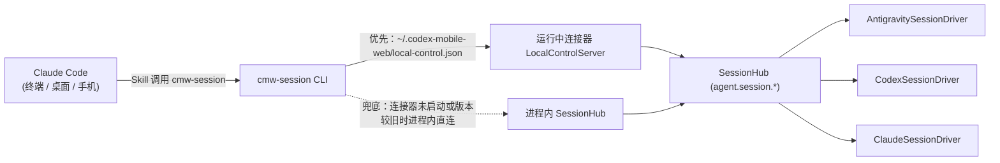

# 跨原生 App 的统一 Session 层与互调设计

日期：2026-11-27。

## 1 目标与背景

仓库已有两层跨应用抽象：

1. **Project 层**（`src/connector/workspace.ts`）：统一使用本机文件夹绝对路径对齐 `codex`、`claude`、`antigravity` 项目。
2. **只读推送底座**（`src/connector/thread-hub.ts`）：通过 `ThreadSource` 推送变化帧。

但会话的**生命周期与写操作**仍分散在三套原生方言中（Codex 的 `session.create / turn.send`，Claude 的 `claude.create / claude.send`，Antigravity 的 `antigravity.create / antigravity.send` + `file:///c%3A/...` URI + `turnKey`）。

本设计抽出统一的 **Session 控制层**（`src/connector/session-hub.ts` 与 `src/shared/sessions.ts`），并通过 **全局 CLI（`cmw-session`）+ Claude Skill** 打通「在 Claude Code 中无缝触发、监控、续聊 Antigravity（以及 Codex / Claude）任务」的完整体验。

## 2 架构与调用路径

- **优先走运行中连接器的 `LocalControlServer`**：连接器启动时除写入 `<dataDir>/local-control.json` 外，在非访客模式下同步在 `~/.codex-mobile-web/local-control.json` 写入本机发现指针，并支持透传 `actor`（如 `{userId: "agent:claude-code", name: "Claude Code"}`）。这样新发起的 Antigravity 会话同时在 **Antigravity 桌面端**和**手机网页端**实时可见，且消息气泡可标记发起方为 `Claude Code`。
- **无感进程内兜底**：若当前电脑未启动连接器，或后台运行的是尚未包含 `agent.session.*` 的旧版便携包，`cmw-session` 自动回退到进程内 `SessionHub`（使用 `~/.codex-mobile-web/cli-operations.sqlite` 独立账本直连本机 Antigravity Hub），无需用户手工重启服务也能立即使用。

## 3 统一契约（`agent.session.*`）

| 动作 | 说明 |
| --- | --- |
| `agent.session.list` | 按 `service`（或全部应用合并）和可选 `cwd`、`search` 列出 `UnifiedSessionSummary[]` |
| `agent.session.get` | 读取归一化后的 `UnifiedSessionSnapshot`（统一阶段 `phase`、本轮回复 `lastAssistantReply`、待处理 `requests`、后台任务 `backgroundTasks`） |
| `agent.session.start` | 校验并自动在目标应用注册 `cwd` 项目（避免 Antigravity 会话落入 `outside-of-project`），默认以 **`turbo`** 最高自动权限启动并发送首条消息 |
| `agent.session.send` | 向已有会话追加消息（支持 `queue` / `steer` / `now`），内部自动补齐 `turnKey`、`expectedTurnId` 等底层状态校验 |
| `agent.session.wait` | 订阅会话变化并挂起等待，直到本轮结束（`completed`）、卡在提问/审批（`approval_needed`）、出错（`error`）或超时（`timeout`）；携带发送前基线防止刚提交时读到上一轮空闲状态提前返回 |
| `agent.session.respond` | 用统一的 `allow / allowSession / deny` + `answers` 回应待处理审批或提问 |
| `agent.session.stop` | 停止目标会话当前轮次（Antigravity 可选连带停止后台任务） |

### 权限档位映射（默认 `turbo`）

跨应用派发任务默认采用 `autonomy: 'turbo'`，最大限度减少中途审批打断：

| 统一档位 | Antigravity | Codex | Claude Code |
| --- | --- | --- | --- |
| `turbo`（默认） | `AGENT_PERMISSION_PRESET_TURBO` | `approvalPolicy: 'never'` | `bypassPermissions` |
| `auto` | `AGENT_PERMISSION_PRESET_AUTO` | `approvalPolicy: 'never'` | `auto` |
| `review` | `AGENT_PERMISSION_PRESET_REQUEST_REVIEW` | `approvalPolicy: 'on-request'` | `default` |
| `default` | `AGENT_PERMISSION_PRESET_DEFAULT` | 沿用本机配置 | 沿用默认配置 |

## 4 Claude Code 无缝协作体验

在 Claude Code 中通过全局 Skill（`~/.claude/skills/antigravity/SKILL.md`）引导两种协作节奏：

1. **前台秒级投递 + 后台挂起自动唤醒（默认）**：
   - 先在前台执行 `cmw-session start --to antigravity --cwd "<目录>" --stdin`，1 秒内确认 Antigravity Hub 在线、项目对齐并拿到 `sessionId`，立即告知用户任务已启动。
   - 紧接着用 Claude Code 原生后台任务（`run_in_background: true`）执行 `cmw-session wait <sessionId> --to antigravity`。用户可继续在当前 Claude 会话做别的事；一旦 Antigravity 跑完或触发 `ask_question` 等交互，`wait` 进程退出，Claude Code 自动被 `<task-notification>` 唤醒并汇报结果或转达问题。
2. **纯异步投递（Fire-and-Forget）**：
   - 用户明确表示“发过去就行 / 不用等结果”时，只执行 `cmw-session start`，用户可在 Antigravity 桌面或手机端随时查看。
