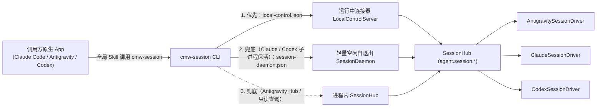

# 跨原生 App 的统一 Session 层与双向互调设计

日期：2026-11-27。

## 1 目标与背景

仓库已有两层跨应用抽象：

1. **Project 层**（`src/connector/workspace.ts`）：统一使用本机文件夹绝对路径对齐 `codex`、`claude`、`antigravity` 项目。
2. **只读推送底座**（`src/connector/thread-hub.ts`）：通过 `ThreadSource` 推送变化帧。

但会话的**生命周期与写操作**仍分散在三套原生方言中（Codex 的 `session.create / turn.send`，Claude 的 `claude.create / claude.send`，Antigravity 的 `antigravity.create / antigravity.send` + `file:///c%3A/...` URI + `turnKey`）。

本设计抽出统一的 **Session 控制层**（`src/connector/session-hub.ts` 与 `src/shared/sessions.ts`），并通过 **全局 CLI（`cmw-session`）+ 双向全局 Skill** 打通：
- **Claude Code → Antigravity**（`~/.claude/skills/antigravity/SKILL.md`）
- **Antigravity → Claude Code**（`~/.gemini/config/skills/claude-code/SKILL.md`）
- 以及任意端与 **Codex**（`--to codex`）之间的双向无缝协作。

## 2 架构与进程生命周期管理

- **优先走运行中连接器的 `LocalControlServer`**：连接器启动时除写入 `<dataDir>/local-control.json` 外，在非访客模式下同步写入 `~/.codex-mobile-web/local-control.json`，并自动识别调用方环境变量（`ANTIGRAVITY_CONVERSATION_ID` → `Antigravity`，`CLAUDECODE` → `Claude Code`，`CODEX_THREAD_ID` → `Codex`）记录到 `Ledger.message_senders`。新发起的会话在**目标桌面端 / CLI** 和**手机网页端**实时可见，且消息气泡直接标出发起方名称。
- **针对 Claude Code / Codex 的轻量守护兜底（`session-daemon.json`）**：
  - Antigravity 自身已有桌面 `language_server.exe` 常驻 Hub，短生命周期 CLI 提交消息后即可立即退出。
  - 而 Claude Code（`@anthropic-ai/claude-agent-sdk` 子进程）与 Codex（`app-server` 子进程）由宿主进程持有。若当前电脑未启动新版连接器，`cmw-session start --to claude` 会自动在后台拉起轻量 `session-daemon`（写入 `~/.codex-mobile-web/session-daemon.json`），使 `start` 在 1~2 秒内返回 `session_id`，而 `claude.exe` 继续在守护进程中完整运行并供后续 `wait` / `get` / `send` / `respond` / `stop` 复用；所有会话空闲 10 分钟后守护进程自动退出。

## 3 统一契约（`agent.session.*`）

| 动作 | 说明 |
| --- | --- |
| `agent.session.list` | 按 `service`（或 `all` 三端合并）和可选 `cwd`、`search` 列出 `UnifiedSessionSummary[]` |
| `agent.session.get` | 读取归一化后的 `UnifiedSessionSnapshot`（统一阶段 `phase`、本轮回复 `lastAssistantReply`、待处理 `requests`、后台任务 `backgroundTasks`） |
| `agent.session.start` | 校验并自动在目标应用注册 `cwd` 项目（避免 Antigravity 会话落入 `outside-of-project`，并同步写入 Claude 项目表），默认以 **`turbo`** 最高自动权限启动并发送首条消息 |
| `agent.session.send` | 向已有会话追加消息（支持 `queue` / `steer` / `now`），内部自动补齐 `turnKey`、`expectedTurnId` 等底层状态校验 |
| `agent.session.wait` | 订阅会话变化并挂起等待，直到本轮结束（`completed`）、卡在提问/审批（`approval_needed`）、出错（`error`）或超时（`timeout`）；携带发送前基线防止刚提交时读到上一轮空闲状态提前返回 |
| `agent.session.respond` | 用统一的 `allow / allowSession / deny` + `answers` 回应待处理审批或提问 |
| `agent.session.stop` | 停止目标会话当前轮次（Antigravity 可选连带停止后台任务） |

### 权限档位映射（默认 `turbo`）

| 统一档位 | Antigravity | Claude Code | Codex |
| --- | --- | --- | --- |
| `turbo`（默认） | `AGENT_PERMISSION_PRESET_TURBO` | `bypassPermissions` | `approvalPolicy: 'never'` |
| `auto` | `AGENT_PERMISSION_PRESET_AUTO` | `auto` | `approvalPolicy: 'never'` |
| `review` | `AGENT_PERMISSION_PRESET_REQUEST_REVIEW` | `default` | `approvalPolicy: 'on-request'` |
| `default` | `AGENT_PERMISSION_PRESET_DEFAULT` | 沿用默认配置 | 沿用本机配置 |

## 4 双向无缝协作体验

两端完全对称，均采用**「前台秒级投递拿 ID + 原生后台挂起自动唤醒」**：

1. **Claude Code 触发 Antigravity**（`skills/cross-app-session/SKILL.md` → `~/.claude/skills/antigravity/SKILL.md`）：
   - 前台运行 `cat <<'EOF' | cmw-session start --to antigravity --cwd "$PWD" --stdin` 秒回 `session_id`；
   - 后台运行 `cmw-session wait <session_id> --to antigravity --after-send`（Claude Code `run_in_background: true`），完成或提问时通过 `<task-notification>` 自动唤醒 Claude。
2. **Antigravity 触发 Claude Code**（`skills/antigravity-to-claude/SKILL.md` → `~/.gemini/config/skills/claude-code/SKILL.md`）：
   - 前台运行 PowerShell `@' ... '@ | cmw-session start --to claude --cwd . --stdin` 秒回 `session_id`（会话写回 `~/.claude/projects`，终端 `claude --resume` 与手机网页立即可见）；
   - 后台运行 `cmw-session wait <session_id> --to claude --after-send`（Antigravity `run_command` 设 `WaitMsBeforeAsync: 500`），完成或提问时自动唤醒 Antigravity 汇总结果。
