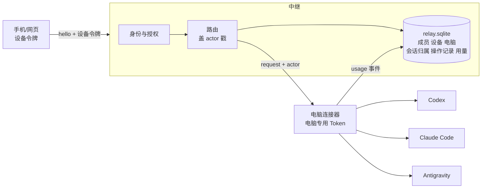

# 团队账号、会话归属与用量统计：设计（草案）

状态：方案已确认（§11），P1 和 P2 已实现并通过自动测试，未做真机和公网部署验收。日期：2026-11-21。本设计推翻了 [DESIGN.md §7](../../DESIGN.md#7-自托管与最小访问控制) 中“不增加账号、邀请制、逐设备撤销”的决定，该节和 [PRIVACY.md](../../PRIVACY.md) 已同步。启用步骤见 [DEPLOY.md](../../DEPLOY.md#团队成员可选)，实际范围见 §12（P1）和 §13（P2）。

## 1 现状与约束

| 现状 | 对本设计的影响 |
| --- | --- |
| 一个中继只有一个实例 Token，手机和电脑共用；持有者权限完全相同 | 无法区分人，也无法只吊销某一个人 |
| 中继无状态：在线连接和路由都在内存，容器 `read_only` | 要保存成员和统计，中继必须加数据卷 |
| 会话存在各电脑的原生目录（`~/.codex`、`~/.claude`、`~/.gemini`），本身没有“人”的概念 | 归属必须由我们自己记录；直接在电脑上开的会话没有归属 |
| 一台电脑的连接器以一个系统用户运行 | 同一台电脑上的成员之间**不是安全隔离**，与访客模式同理 |
| 已有 `connectorTokens`：Token 绑定到某个电脑 ID | 可直接扩展为“每台电脑一个连接器 Token” |
| 连接器有操作账本（`operations`，按 opId 去重） | 每个写操作已有稳定 ID，适合挂上“谁做的” |
| Codex 推送 `thread/tokenUsage/updated`（`total` / `last`）；Claude Agent SDK 的 `result` 带 `modelUsage`、`total_cost_usd` | 用量有可靠来源，但口径要处理（见 §6） |

## 2 目标与不做

目标：

1. **每人独立登录**：每人每台设备一个凭据，可单独停用、单独吊销。
2. **知道是谁做的**：谁创建（或分叉）了会话，谁发送、停止、审批、归档。
3. **每人用量**：轮次、会话数、token（按服务、模型、电脑）。不折算金额。
4. **管理员管理**：邀请成员、设定角色、管理可用的电脑。

本期不做：

- 成员之间的安全隔离。同一台电脑上，模型执行命令时始终拥有该系统用户的全部权限；“只看我的”是筛选，不是权限边界。需要真正隔离见 §9 P3。
- 计费、配额拦截。只统计，不按用量阻止发送。
- SSO（飞书、企业微信、GitHub 等）和多组织。一个中继就是一个组织。多个团队各运行一个中继实例，步骤见 [DEPLOY.md](../../DEPLOY.md#一台服务器运行多个团队)（2026-11-25 起这样部署）。

## 3 总体结构



原则：

- **身份只在中继认定。** 中继认出设备令牌对应的人，转发请求时盖上 `actor` 戳；手机自报的身份一律忽略。连接器信任中继（双方用电脑专用 Token 认证），不接触任何成员凭据。
- **中继集中保存元数据，不保存内容。** 存成员、会话归属、操作类型和 token 数；不存提示词、回复、文件内容。会话标题快照是例外（见 §5），需要在隐私说明中写明。
- **连接器负责“这一轮用了多少”。** 只有它看得到运行端的用量事件；它把用量连同发起人上报给中继，断线时先存本地，重连后补发。

## 4 账号、登录与设备

### 4.1 角色

| 角色 | 能做什么 |
| --- | --- |
| 所有者（owner） | 管理员的全部权限；转让所有权；至少保留一个 |
| 管理员（admin） | 邀请/停用成员，改角色（不能改所有者），管理电脑和电脑访问，看全员用量与操作记录 |
| 成员（member） | 使用被授权的电脑；看自己的用量和操作记录 |

电脑访问：每个成员可用哪些电脑。默认“全部电脑”，管理员可改为指定列表。管理员始终可用全部电脑。

### 4.2 登录方式：邀请链接 + 设备令牌（推荐）

沿用现在“扫码/链接带 Token”的体验，不引入密码：

1. 管理员在“成员”页新建成员（名字、角色、可用电脑），得到一次性邀请链接 `https://域名/#invite=<code>` 和二维码。邀请 24 小时有效，只能用一次；库里只存 code 的哈希。
2. 成员在手机或电脑上打开链接，填写设备名（默认取浏览器信息），页面用邀请码换取**设备令牌**（256 位随机数），保存在该浏览器的 localStorage，并从地址栏去掉 fragment。
3. 以后连接时 `hello` 里带设备令牌，流程与现在相同。中继存令牌的 SHA-256，按哈希查找。
4. 同一成员要在第二台设备登录：在“我的设备”里生成一个新的设备邀请，或者由管理员再发一次邀请。
5. **吊销**：成员在自己的设备上“退出登录”即吊销该设备；管理员可吊销任意设备或停用成员。吊销、停用后中继**立即断开**相关连接，不需要重启中继或更换全局 Token。

为什么不用账号密码：要多做密码强度、找回、防暴力破解；在手机上输入也不方便。为什么暂不做 SSO：需要对接外部身份源和回调地址，对小团队自托管太重。两者都可以以后加在“换取设备令牌”这一步前面，不影响后面的设计。

### 4.3 初始化与兼容

- **个人模式（默认，兼容现有部署）**：中继库里没有成员时，行为与现在完全相同，实例 Token 对手机和电脑都有效。
- **启用团队模式**：在服务器上运行 `docker compose exec relay node build/relay.mjs team init --name <名字>`，创建所有者并打印首个邀请链接。此后实例 Token **不再允许手机登录**，只保留给电脑连接器做兼容。
- **找回**：所有者的设备全丢了，在服务器上运行 `team invite --user <名字>` 重新发邀请。能登录服务器即视为所有者。
- **电脑连接器**：管理员在“电脑”页为每台电脑生成专用 Token（沿用 `connectorTokens` 的绑定机制，改为存进库里），粘贴到电脑的配置窗口。旧电脑继续用实例 Token 也能连上，“电脑”页标注“使用共享 Token，建议更换”。

## 5 授权、归属与操作记录

### 5.1 中继的检查点

| 位置 | 现在 | 团队模式 |
| --- | --- | --- |
| `hello` | 比对实例 Token | 查设备令牌 → 成员、设备、角色；停用/吊销则 `4401` |
| `ready` | 返回电脑列表 | 另返回 `user: {id, name, role}`；电脑列表按授权过滤 |
| `machines` 广播 | 发给所有手机 | 每个手机只收到它能用的电脑 |
| `request` 路由 | 只查电脑在线 | 先查电脑授权；通过后给转发的请求加 `actor: {userId, deviceId}` |
| `changed` / `live` | 发给所有手机 / 正在看的手机 | 只发给有该电脑授权的手机 |
| `team.*` 请求 | 无 | 中继自己处理，不转发到电脑（见 §7） |

会话级权限：**本期所有成员对被授权电脑上的全部会话可见、可操作，所有写操作都留记录**。如果需要“别人的会话只能看不能发”，在中继路由处按会话归属加一条规则即可（§9 P3 可选），不影响数据模型。

### 5.2 会话归属

- 中继在转发 **创建类请求** 的回执时记录归属：`session.create`、`session.fork`、`claude.create`、`claude.fork`、`antigravity.create`。从回执取会话 ID，写入 `threads`（电脑、服务、会话 ID、创建人、创建时间、分叉来源）。
- 回执丢失（超时、断线，结果“待核实”）时：连接器上报的用量事件也带发起人和会话 ID，中继以“该会话第一次出现的发起人”补记归属。
- **没有归属的会话**（直接在电脑上开的、启用团队模式之前就有的）显示为“本机”。管理员可以手动认领给某个成员。
- 标题快照：中继在转发会话列表回执时，为已有归属的会话更新标题和更新时间快照，用于跨电脑的“我的会话”和统计页。这与现在网页端置顶会话保存标题快照的做法一致。

### 5.3 操作记录

中继在每个**写操作**的回执返回时写一行 `activity`：时间、成员、设备、电脑、服务、动作、会话 ID、opId、结果（已接受 / 已拒绝 / 待核实）。写操作沿用连接器已有的列表（`turn.send`、`turn.stop`、`request.respond`、`session.archive`、`claude.send` 等，即各服务的 `mutations`）。不记录消息正文；审批只记“批准/拒绝”和请求类型，不记命令内容。

连接器账本的 `operations` 表加一列 `actor`，排查问题时两边能对上；连接器同时记下“这一轮由谁发起”，用于 §6 的用量归属。

### 5.4 网页上的展示

- 会话列表每行右侧显示创建人头像（首字），“本机”会话显示电脑图标。列表上方加筛选：全部 / 我的 / 某成员。本期在已加载的页内筛选，加载更多后继续筛。
- 会话状态卡片加一行：“由 张三 创建 · 李四 最后发送”。
- 多人参与同一会话时，用户消息气泡上方显示发送人名字。需要把 opId 和运行端的 turnId 对上，放在 P2。
- 右上角账号菜单：当前成员名、我的设备、我的用量、退出登录；管理员多出“团队管理”。

## 6 用量统计

### 6.1 数据来源与口径

| 服务 | 来源 | 每轮用量的算法 | 待验证 |
| --- | --- | --- | --- |
| Codex（连接器自起的 app-server） | `thread/tokenUsage/updated`，带 `turnId` | 这一轮第一条更新的 `total − last` 是开始前的总数，`turn/completed` 前最后一条的 `total` 是结束时的总数，两者相减 | 压缩后 `total` 是否会回落（回落时按 0 计） |
| Codex（桌面 IPC 会话） | 桌面快照的 `latestTokenUsageInfo` | 同上，用快照前后差值 | 桌面路径能否稳定拿到一轮结束时的快照 |
| Claude Code | SDK `result` 消息的 `modelUsage` | SDK 文档写明它在流式会话里是**累计值**，每条 result 带到目前为止的总数，所以与上一条相减；续接或分叉的会话从记录里的旧总数继续，所以每个会话要保存上一次的累计值，没有记录时第一条 result 只作基线不计入 | 续接时的基线；`/clear` 后清零的处理 |
| Antigravity | 无用量接口 | 只统计轮次 | — |

统计项：轮次、输入 token（含缓存命中）、缓存命中、输出 token（Codex 含推理）、推理 token。不折算金额（§11），也不统计运行时长。

**订阅账号的说明**：ChatGPT、Claude 订阅登录时，额度属于电脑上的那个账号，全员共用。token 数表示各人占了多少比例。

### 6.2 归属规则

- 一轮的用量算给**发起这一轮的人**，即触发 `turn.send` / `claude.send`（或排队消息）的那个 opId 的 actor。
- 运行中“立即追加”（Steer）的消息并入当前轮，用量仍算给这一轮的发起人；操作记录里单独记一次追加。
- 在电脑上直接发起的轮次算给“本机”。

### 6.3 上报与不丢

```text
连接器: 一轮结束 → 写 usage_outbox（事件 ID = 电脑ID:服务:会话:轮次）→ 发 {type:'usage', events}
中继:   INSERT OR IGNORE 到 usage → 回 {type:'usage.ack', ids}
连接器: 收到 ack 后删除 outbox；重连时补发未确认的
```

- 至少发送一次，事件 ID 去重，所以重复发送不会重复计数。
- 中继在 `ready.features` 里带 `'team'`；连到不支持团队功能的旧中继时，连接器只写 outbox 不发送，outbox 最多保留 30 天。
- 中继离线期间的用量在电脑上排队，恢复后补齐，统计页注明“最近数据可能延迟”。

### 6.4 统计页

- 成员看自己的；管理员看全员。
- 时间：今天、7 天、30 天；粒度：按日。
- 维度：成员 × 服务 × 模型 × 电脑。页面上是三个汇总数、每天 token 的柱状图、按成员和按应用 · 模型的表；CSV 含全部维度。
- 导出 CSV。
- 数据量很小（几个人、每天几百轮），直接在 SQLite 上按需 `GROUP BY`，不做预聚合。

## 7 协议改动

| 方向 | 帧 | 变化 |
| --- | --- | --- |
| 手机 → 中继 | `hello` | `token` 改为设备令牌；或带 `invite` + `deviceName` 用邀请码换令牌 |
| 中继 → 手机 | `ready` | 加 `user`、`role`；换令牌时加 `deviceToken`（只此一次） |
| 手机 → 中继 | `{type:'team', id, action, payload}` | 中继自己处理并回 `response`，不需要 `machineId` |
| 中继 → 连接器 | `request` | 加 `actor` |
| 连接器 → 中继 | `usage` / 中继 → 连接器 `usage.ack` | 新增 |
| 中继 → 手机 | 关闭码 `4403` | 新增：没有该电脑的授权 |

`team.*` 动作：`me`、`devices.list/revoke/invite`、`members.list/create/update/disable`、`invites.create/revoke`、`machines.list/createToken/revokeToken/setAccess`、`threads.claim`、`usage.query`、`activity.query`。成员管理类动作中继按角色校验。

## 8 数据模型（中继 `relay.sqlite`）

```sql
users        (id, name, role, status, all_machines, created_at)
devices      (id, user_id, name, token_hash UNIQUE, created_at, last_seen_at, revoked_at)
invites      (id, user_id, code_hash UNIQUE, created_by, expires_at, used_at)
machines     (id, name, connector_token_hash UNIQUE NULL, guest, created_at, last_seen_at)
machine_access (user_id, machine_id, PRIMARY KEY(user_id, machine_id))
threads      (machine_id, service, thread_id, owner_id NULL, parent_thread_id, title, created_at, updated_at,
              PRIMARY KEY(machine_id, service, thread_id))
activity     (id, ts, user_id, device_id, machine_id, service, action, thread_id, op_id, state)
usage        (event_id, model, ts, machine_id, service, thread_id, turn_id, user_id NULL, turns,
              input_tokens NULL, cached_input_tokens NULL, output_tokens NULL, reasoning_tokens NULL,
              PRIMARY KEY(event_id, model))  -- 一轮一个或多个模型各一行，只有第一行的 turns 为 1
```

连接器账本（`operations.sqlite`）新增：`operations.actor`、`usage_outbox(id, payload, created)`、`claude_usage_cursor(session_id, totals, updated)`。

保留期：`activity` 和 `usage` 默认 400 天，可配置；成员停用后数据保留，名字显示为“（已停用）”。

## 9 分期

| 阶段 | 内容 | 可验收的结果 |
| --- | --- | --- |
| **P1 身份与归属** | 中继 SQLite 与数据卷；`team init` 命令；邀请、设备令牌、吊销；电脑专用 Token 与电脑授权；`actor` 戳；会话归属与操作记录；网页登录页、账号菜单、列表归属与筛选、成员/电脑管理页 | 两个人各自登录，列表能看出谁开的会话；吊销一台设备后它立即掉线；没授权的电脑看不到 |
| **P2 用量统计** | 连接器用量事件和 outbox；Codex、Claude 的差值计算；中继入库；统计页和 CSV；会话内显示发送人 | 两人各跑几轮，统计页的轮次、token 与运行端数据对得上；中继重启期间的用量恢复后补齐 |
| **P3 可选** | 他人会话只读策略；按归属在服务端分页筛选；账号密码或 SSO；一台电脑上按成员隔离（每人一套 `CODEX_HOME` / `CLAUDE_CONFIG_DIR` 和工作区，复用访客模式的目录机制；要接成员个人电脑作为[执行设备](../exec-devices/DESIGN.md#第二阶段成员个人的电脑)时，需做到每人一个系统用户、一个连接器） | 视需求单独设计 |

## 10 代码落点

- **中继**：新增 `src/server/team/`，分为 `store.ts`（建表、查询）、`auth.ts`（邀请、令牌、哈希）、`actions.ts`（`team.*`）、`usage.ts`（入库、查询）。`relay.ts` 只在 `hello`、路由、广播、`finish` 四处调用这些模块，保持路由本身简单。`server/main.ts` 加 `team` 子命令。
- **连接器**：`ledger.ts`（actor 列、outbox、Claude 累计基线）、`control.ts`（Codex 每轮 `total` 差值、发起人）、`claude-runtime.ts`（`result` 转成用量事件）、`main.ts`（上报和 ack）。
- **网页**：`client.ts` 加 `team()` 请求和 `#invite=` 处理；`main.tsx` 的 Token 输入页改为“邀请码 / 管理员初始化”；新增账号菜单和团队管理路由（成员、电脑、用量、操作记录）；会话列表行加归属标记。
- **部署**：`compose.yaml` 增加 `relay-data:/data` 卷和 `BRIDGE_DATA=/data`，根文件系统保持只读；`DEPLOY.md` 加备份说明（`relay.sqlite` 用 SQLite 在线备份，或停容器后复制）。
- **测试**：中继认证与授权（吊销后断开、无授权电脑看不到也发不了请求、伪造 actor 被覆盖）、归属记录、outbox 去重补发、Codex 和 Claude 的用量差值（含续接基线）。

## 11 已确认（2026-11-21）

1. **登录方式**：邀请链接 + 设备令牌。不做账号密码和 SSO。
2. **别人的会话**：全员可见、可操作，只做记录。
3. **统计口径**：只看 token 和轮次，不折算金额。
4. **一台电脑多人共用**：成员之间可以互相看到会话和文件，暂不做隔离。

## 12 P1 实现记录（2026-11-21）

已实现：

- 中继：`src/server/team/` 的 `store.ts`（建表与查询）、`actions.ts`（`team.*` 请求、归属与操作记录的规则）、`cli.ts`（`team init` / `invite` / `list`）。`relay.ts` 在登录、授权、转发盖戳、回执记录四处接入。数据库打不开时按个人模式运行。
- 连接器：`ledger.ts` 的 `operations.actor` 列。`main.ts` 用 `AsyncLocalStorage` 把中继标注的 actor 带到这次请求发起的所有操作，各应用的桥接代码不用改。
- 网页：登录页接受邀请链接或 Token；“选项 → 团队”有四页：我的设备、成员、电脑、操作记录。“选项 → 只看我的会话”在已加载的列表里筛选。会话行显示创建人首字；Codex 的状态卡片显示创建人和最后发送人。
- 部署：Compose 加 `relay_data` 数据卷，Dockerfile 预建 `/data`。

与上文的差别：

- 没有归属的会话不显示标记（原计划显示电脑图标），避免在个人会话很多的电脑上满屏图标。
- 只有“全部 / 只看我的”两档筛选，没有按某个成员筛选。
- 管理员认领会话：中继已有 `team.threads.claim`，网页还没有入口。
- Claude Code 和 Antigravity 的会话页暂不显示创建人，列表上有标记。

测试：`test/team.test.ts`（邀请换令牌、一次性与过期、最后一位所有者、电脑授权、伪造 actor 被覆盖、归属与列表标注、停用立即断开、电脑专用 Token、连接器记录 actor、邀请链接解析）。全部 236 个测试通过。

## 13 P2 实现记录（2026-11-21）

已实现：

- 连接器 `src/connector/usage-meter.ts`：Codex 每轮差值、Claude Code 累计值的差值和基线规则。`ledger.ts` 加 `usage_outbox`（未确认的轮次，最多留 30 天）和 `claude_usage_cursor`（每个 Claude Code 会话上一轮结束时的累计值）。每一轮的发起人取自开始这一轮的操作的 actor（§5.3），所以排队消息算给排队的人。
- Codex：`control.ts` 在发起新一轮时记下操作 ID；连接器自己的 app-server 会话按 `thread/tokenUsage/updated` 算 token；桌面会话在发送时记下桌面快照里的总数，等快照里这一轮结束时再取总数相减。在电脑上直接开始的桌面轮次连接器看不到，不计入；app-server 里不是手机发起的轮次记为“电脑本机”。
- Claude Code：`claude-runtime.ts` 在空闲时收到的消息上记下操作 ID，每条 `result` 发出 `turn` 事件。新建的会话从 0 开始；续接的会话从保存的累计值开始，没有保存过就只把第一轮当基线、不计 token；从某条消息改写（`resumeAt`）后同样只当基线；累计值变小（清空过会话）或崩溃时报 0 的一轮不计 token。轮次都照常计入。
- Antigravity：发送和新建成功时记一轮，没有 token。
- 上报：`main.ts` 在中继 `ready.features` 含 `team` 时每批最多 200 条发 `usage`，收到 `usage.ack` 后删除并继续；60 秒内没有确认的批次会重发。中继 `addUsage` 按事件 ID 去重，已存过和格式不对的事件也确认，免得连接器一直重发。
- 中继：`usage` 表与 `team.usage` 查询，按客户端时区分日汇总。成员只能查自己，管理员可按成员筛选。会话没有归属时，第一条带发起人的用量顺便补上归属。
- 网页：团队面板新增“用量”页，每人都能打开；数据图用单一蓝色柱（`#2a78d6`，已用调色板校验脚本检查对白底的对比度）。

与上文的差别：

- 时间范围只有今天、7 天、30 天，没有自定义。
- 不统计运行时长、活跃天数和新建会话数。
- 会话内显示每条消息的发送人见 §14。

测试：`test/usage-stats.test.ts`（Codex 差值、Claude 基线与清零、Codex app-server 和桌面两条路径、Claude 轮次与发起操作、中继去重与按成员查询、网页的数字格式、日期范围和 CSV）。全部 242 个测试通过。在浏览器里用本机临时中继和 74 条模拟轮次检查过桌面宽度和手机宽度下的用量页。

## 14 消息发送人（2026-11-21）

会话里每条从手机发出的消息记下发送人；一个会话里出现两个以上成员时，网页在每条用户消息上方显示名字（自己的显示“我”）。

- 连接器在发送成功时写 `message_senders`（只在中继标注了发起人时写，保留 400 天）。原生会话记录里没有我们的标识，所以按应用对应：
  - Codex：按轮次。新一轮记 `start`，运行中追加记 `steer`，都带轮次 ID。一轮的用户消息条数和记录条数一致时按顺序对应；不一致（例如桌面上也追加过）时只给开始这一轮的消息标名字，不会标错。
  - Claude Code 和 Antigravity：SDK 不能指定消息 ID，按发送的原文（去掉首尾空白、统一换行后的哈希）从最新往前配对。重复的短消息（如“继续”）与最近的发送配对；Antigravity 只读记录末尾一段，从后往前也能对齐。
- 读会话时连接器给 `MessageItem.sender`（Antigravity 为消息的 `sender`）填上成员 ID 和名字；中继在 `*.read` / `*.watch` 回执中换成成员当前的名字。
- 网页 `web/senders.tsx`：`SenderScope` 判断会话里是否有别人的消息，`SenderLabel` 显示在用户气泡上方。Codex 和 Claude Code 共用 `ConversationTurn`，Antigravity 在 `antigravity-messages.tsx`。
- 同时补上 Codex 改写消息（`turn.edit`）开始的新一轮的用量归属和发送人。

未验证：Antigravity 记录里的用户消息文字是否与连接器发送的原文完全一致；不一致时这些消息只是没有名字。

测试：`test/message-senders.test.ts`。

## 15 审查后的修正（2026-11-21）

- 操作的发起人改存在单独的 `operation_actors` 表，不再给 `operations` 加列。连接器更新失败、脚本退回旧版本时，旧版本仍按原来的五列写操作记录。已经加过列的数据库在启动时把发起人搬过去、再删掉这一列。
- Codex 运行中的整轮推送也带上发送人；网页在用推送替换一轮或一条消息时，保留上次读取时已有的发送人，旧连接器的推送不会把名字冲掉。
- 管理员收回某台电脑后，该成员在那台电脑上打开的网页预览立即结束；设备被移除或成员被停用时，它的全部预览也立即结束，并通知电脑停止。
- 用量和发送人的写入出错只记日志，不再让已经发出的消息被报成失败。
- Antigravity 增量读取比较发送人，后来才对上名字的消息会重新发给手机。
- Claude Code 运行中“立即发送”的消息如果结束了当前一轮、自己开始新的一轮，新的一轮算给发它的人；若只是并入当前一轮，仍算给这一轮的发起人。
- 中继处理单条消息时出现意外错误（例如团队数据库被锁），只关闭这一个连接（1011），中继进程继续运行。

测试：`test/team-hardening.test.ts`。其余 8 条小问题（“最后发送”包含失败的发送、离线退出登录不作废设备、邀请在连接中断时作废、CSV 公式注入、命令行邀请会恢复已停用成员、Codex 从队列立即追加记在点击的人名下、夏令时、用量页跨零点不刷新）暂未处理。


## 16 待办：私人项目与私人会话（2026-11-25 记录，未设计）

需求（原话大意）：虽然面向团队协作，但项目和会话都应有“私人”的概念。成员参与协作的同时，可能有些会话不需要给大家看，不想公开。设为私人应是**可选的**，并且是**双向的**。

目前的理解（设计时再确认）：

- 对象有两级：项目和会话。项目设为私人时，其下会话默认也是私人。
- 默认仍是公开，私人需要本人主动设置；“双向”指随时可以在公开和私人之间来回切换，不是一次性的。
- 私人是中继层面的可见性，不是安全隔离：同一台电脑上模型和本机用户仍能看到这些文件（与 §2“本期不做”一致，真正隔离仍见 §9 P3）。

设计时要回答的问题：

- 谁能把一个会话设为私人：只有创建人，还是管理员也能？“本机”（无归属）会话能不能设为私人、归谁？
- 管理员/所有者能否看到别人的私人会话，还是完全不可见？
- 私人会话在会话列表、搜索、置顶、标题快照、操作记录里怎样处理；中继转发列表回执时要按查看人过滤，而不是只在网页上隐藏。
- 用量统计：私人会话的用量照常算进本人和团队总数，但统计页上是否隐藏标题。
- 别人正在看或参与的会话被改成私人时，对方网页上的处理（关闭、只提示）。
- 分叉：从私人会话分叉出的新会话是否继承私人。
